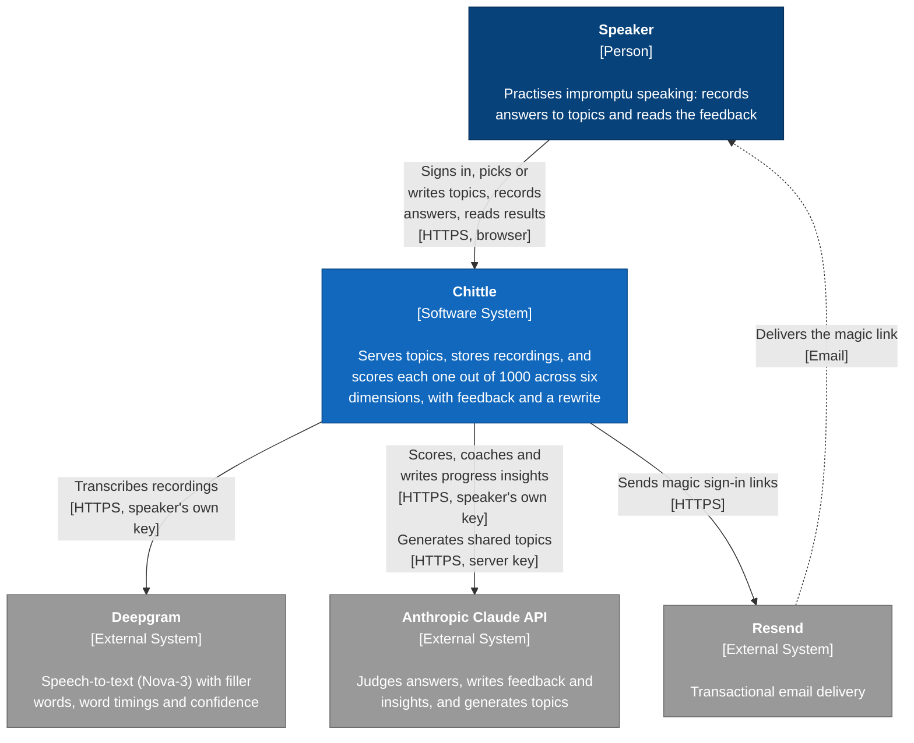

# System context

Chittle is used by one kind of person, the speaker. It depends on three outside services. Deepgram and Anthropic do the assessment, and Resend sends sign-in emails.

## Notes

- Speakers pay for their own assessments. They save a Deepgram key and an Anthropic key on the Account page, and there is no fallback to a server key ([ADR 0002](../adr/0002-per-user-provider-keys.md)).
- Topic generation is the one Anthropic call made with the server's `ANTHROPIC_API_KEY`, because generated topics are shared by every speaker. Without that key, Chittle serves only the predefined topics.
- Without `RESEND_API_KEY`, Chittle logs magic links to the server console rather than emailing them, which is how local development signs in.
