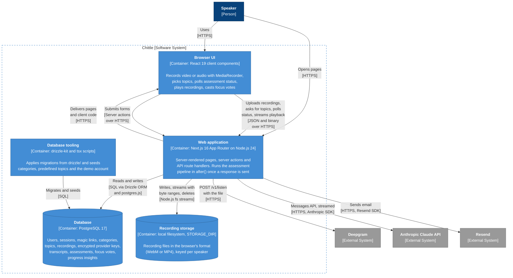

# Containers

Chittle is one Next.js application backed by Postgres and a directory of recording files. The client-side parts run in the speaker's browser, and everything else runs in a single Node.js process. Assessments run in that same process, in Next's `after()` callback, so there is no separate worker or queue ([ADR 0003](../adr/0003-assessments-run-in-after-with-stale-recovery.md)).

## Notes

- The browser talks to the web application through these endpoints:

  | Endpoint | Used for |
  | --- | --- |
  | `GET /api/topics`, `POST /api/topics` | Listing a category's topics and saving a custom topic |
  | `POST /api/topics/next` | Getting the next unseen topic, or choosing a specific one |
  | `POST /api/recordings` | Uploading a finished recording, which starts its assessment |
  | `GET /api/recordings/[id]/assessment` | Polling an assessment's status from the results page |
  | `GET /api/recordings/[id]/file` | Streaming a recording for playback, with range requests |
  | `GET /api/health` | The container health check, which runs `select 1` |

- Sign-in, sign-out, saving and removing provider keys, Assess, Retry, focus votes and deleting recordings or the account are server actions in `src/app/actions.ts`.
- Recording storage sits behind the `Storage` interface in `src/lib/storage/types.ts`. Local disk is the only implementation, so the web application and its files must share one host. More than one app instance would need shared storage and a job queue (see [ADR 0003](../adr/0003-assessments-run-in-after-with-stale-recovery.md)).
- The database tooling ships in the production image so `npm run db:setup` can run inside it.
