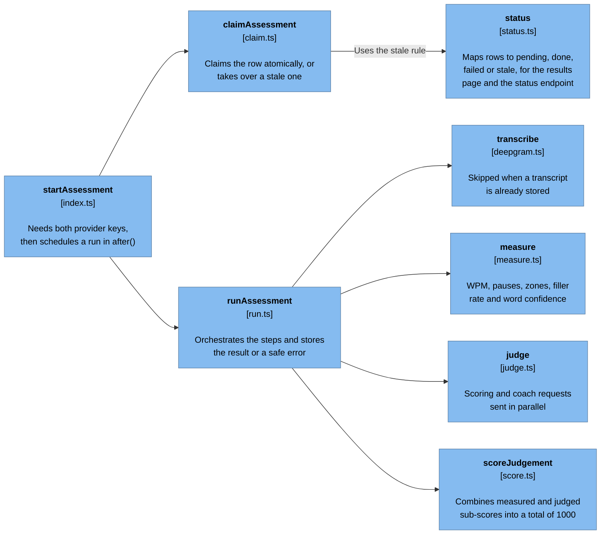

# Components of the web application

This zooms in on the web application container. Routes, server actions and API handlers in `src/app` are the entry points. Domain logic lives in `src/lib`, and each module there owns its tables in `src/db/schema.ts`.

```mermaid
---
config:
  flowchart:
    wrappingWidth: 400
---
flowchart TB
    browser["<b>Browser UI</b><br/>[Container: React client components]"]

    subgraph web ["Web application [Next.js]"]
        direction TB

        subgraph entry ["Entry points"]
            direction LR
            pages["<b>Pages</b><br/>[Component: src/app/**/page.tsx]<br/><br/>Landing, dashboard, login, practice<br/>setup and record, library, results, account"]
            actions["<b>Server actions</b><br/>[Component: src/app/actions.ts]<br/><br/>Sign in and out, provider keys, Assess<br/>and Retry, focus votes, deletion"]
            api["<b>API route handlers</b><br/>[Component: src/app/api]<br/><br/>Topics, recording upload, assessment<br/>status, file streaming, health"]
        end

        auth["<b>Auth</b><br/>[Component: src/lib/auth]<br/><br/>Magic links, hashed tokens,<br/>cookie sessions, email sending"]
        topicsMod["<b>Topics</b><br/>[Component: src/lib/topics]<br/><br/>Picks topics with no repeats per speaker,<br/>saves custom topics, generates new ones"]
        keys["<b>Provider keys</b><br/>[Component: src/lib/provider-keys, crypto.ts]<br/><br/>Checks keys with a test call, encrypts<br/>them with AES-256-GCM, masks them"]
        assessment["<b>Assessment pipeline</b><br/>[Component: src/lib/assessment]<br/><br/>Claims a run, transcribes, measures<br/>Rhythm, Fluency and Clarity, judges Shape,<br/>Brevity and Conviction, scores, stores"]
        insight["<b>Progress insight</b><br/>[Component: src/lib/progress-insight]<br/><br/>Rewrites the speaker's coaching<br/>observation from recent assessments"]
        votes["<b>Focus votes</b><br/>[Component: src/lib/focus-votes]<br/><br/>Saves votes on areas to improve and<br/>feeds recent ones into prompts"]
        dashboard["<b>Dashboard</b><br/>[Component: src/lib/dashboard.ts]<br/><br/>Score history by dimension<br/>and time window"]
        claude["<b>Claude client</b><br/>[Component: src/lib/claude.ts]<br/><br/>Streams a Messages API request<br/>on a given key, with a timeout"]
        storage["<b>Storage</b><br/>[Component: src/lib/storage]<br/><br/>Storage interface and its<br/>local-disk implementation"]
        dbClient["<b>Database client</b><br/>[Component: src/db]<br/><br/>Drizzle schema and one shared<br/>postgres.js connection pool"]
    end

    db[("<b>Database</b><br/>[Container: PostgreSQL]")]
    files[("<b>Recording storage</b><br/>[Container: local filesystem]")]
    deepgram["<b>Deepgram</b><br/>[External System]"]
    anthropic["<b>Anthropic Claude API</b><br/>[External System]"]
    resend["<b>Resend</b><br/>[External System]"]

    browser -- "Requests pages" --> pages
    browser -- "Submits forms" --> actions
    browser -- "Fetches JSON and media" --> api

    pages --> auth
    pages -- "Score history" --> dashboard
    pages -- "Insight card" --> insight
    pages -- "Finds the chosen topic" --> topicsMod
    pages -- "Key hints, has keys" --> keys
    pages -- "Status, previous attempt" --> assessment
    pages -- "Votes on a recording" --> votes
    actions --> auth
    actions --> keys
    actions -- "Assess, Retry" --> assessment
    actions --> votes
    actions -- "Deletes files" --> storage
    api --> auth
    api --> topicsMod
    api -- "Starts on upload" --> assessment
    api -- "Writes and streams files" --> storage

    assessment -- "Reads the speaker's keys" --> keys
    assessment -- "Reads recent votes" --> votes
    assessment -- "Refreshes after a<br/>done assessment" --> insight
    assessment -- "Scoring and coach requests" --> claude
    assessment -- "Reads the recording" --> storage
    insight --> claude

    auth -- "Sends links<br/>[HTTPS]" --> resend
    assessment -- "Transcribes<br/>[HTTPS]" --> deepgram
    keys -- "Checks keys<br/>[HTTPS]" --> deepgram
    keys -- "Checks keys<br/>[HTTPS]" --> anthropic
    topicsMod -- "Generates topics<br/>with Haiku<br/>[HTTPS, server key]" --> anthropic
    claude -- "Opus requests<br/>[HTTPS, speaker's key]" --> anthropic

    storage -- "fs streams" --> files
    dbClient -- "SQL" --> db

    classDef container fill:#438dd5,stroke:#2e6295,color:#fff
    classDef component fill:#85bbf0,stroke:#5d82a8,color:#000
    classDef external fill:#999,stroke:#6b6b6b,color:#fff
    class browser,db,files container
    class pages,actions,api,auth,topicsMod,keys,assessment,insight,votes,dashboard,claude,storage,dbClient component
    class deepgram,anthropic,resend external
    style web fill:none,stroke:#438dd5,stroke-dasharray:5 5
    style entry fill:none,stroke:#5d82a8
```

Every component that reads or writes the database does so through the database client, and some pages and route handlers query it directly. Those arrows are left out to keep the diagram readable. Pages also import shared helpers such as `dimensions.ts`, `format.ts` and `practice.ts`, which aren't drawn.

## Inside the assessment pipeline

`dimensions.ts` defines the six dimensions and their maximums, `frameworks.ts` the answer framework each category is judged against, and `version.ts` the scoring version stored with every assessment.
