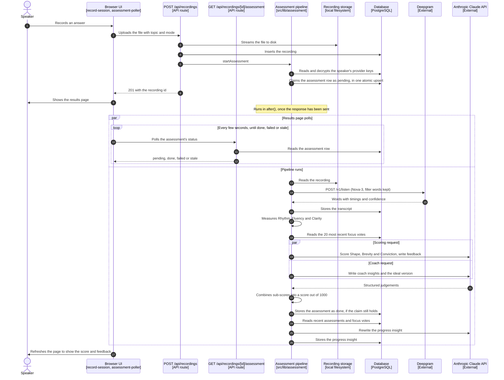

# Assessment flow

This dynamic diagram follows one recording from upload to its results. Assess and Retry on the results page take the same path from `startAssessment` on, and a re-assess skips Deepgram because the transcript is already stored.

## Notes

- If any step fails, the run stores the assessment as failed with a message that's safe to show the speaker, and the results page offers Retry. Secrets are redacted from logged errors.
- A row still pending after about 5 minutes counts as stale, because the process was probably restarted. Retry claims it again ([ADR 0003](../adr/0003-assessments-run-in-after-with-stale-recovery.md)).
- A run only stores its result if its claim is still the current one, so a newer Retry or re-assess wins over an older run.
- If the progress insight fails, the assessment stays done. The dashboard shows the insight once the speaker has two scored assessments.
