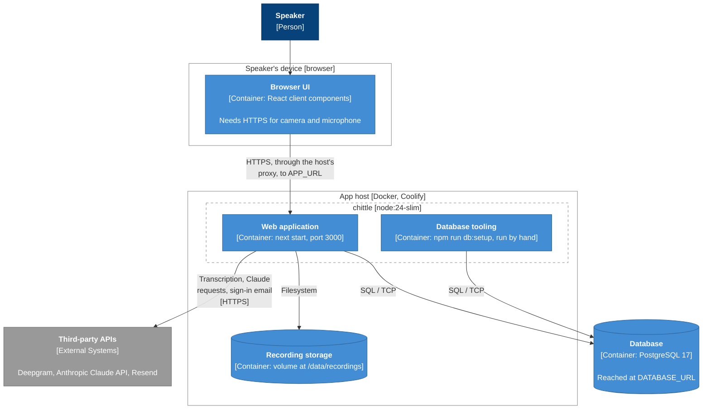
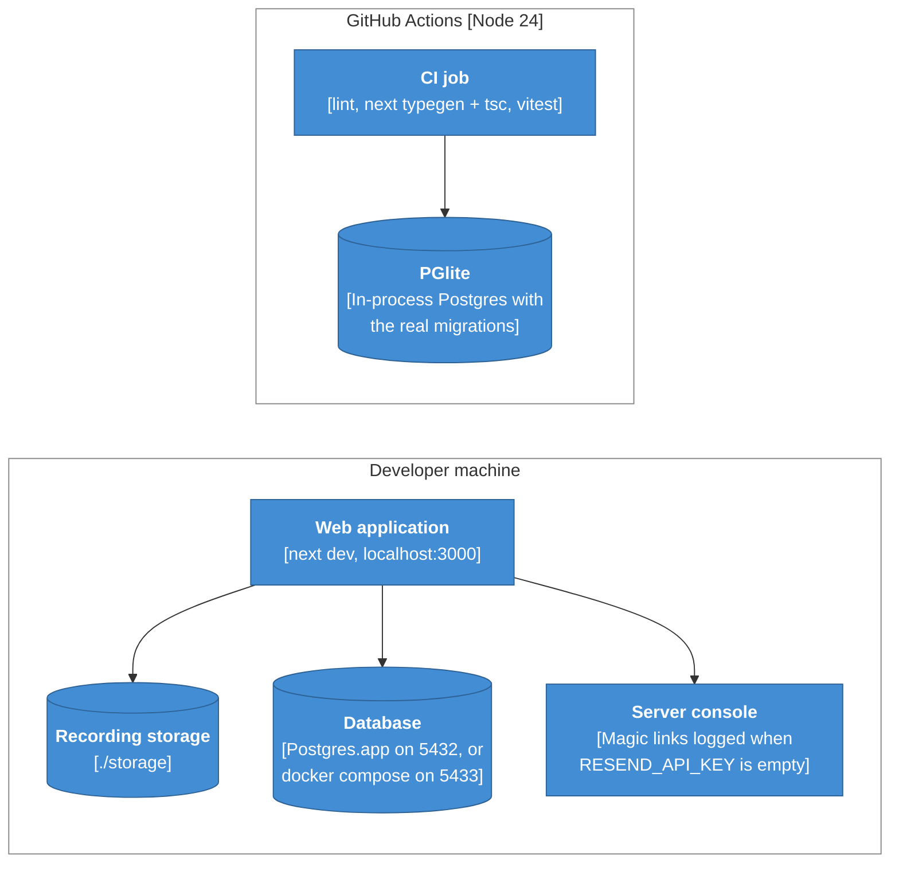

# Deployment

## Production

The `Dockerfile` builds one image that runs the web application. It serves on port 3000, keeps recordings in `/data/recordings` and is health-checked with `curl` against `/api/health`, which is how Coolify checks it. The image keeps its dev dependencies, so migrations and seeding run inside the same container.

The app runs as a single instance. Recordings are on the container's local volume and assessments run inside the web process, so a second instance would need shared storage and a job queue first.

### Configuration

| Variable | Purpose |
| --- | --- |
| `DATABASE_URL` | Postgres connection. Required. |
| `APP_URL` | Public base URL, used to build magic links |
| `STORAGE_DIR` | Recording directory, `/data/recordings` in the image |
| `RESEND_API_KEY`, `EMAIL_FROM` | Magic-link email. Without a key, links are logged instead. |
| `ANTHROPIC_API_KEY`, `TOPIC_MODEL` | Server key for topic generation only |
| `ENCRYPTION_KEY` | Encrypts speakers' provider keys at rest. Changing it makes saved keys unreadable. |

## Local development and CI

Tests need no Postgres server, Docker or API keys. They run against PGlite and always mock Resend, Anthropic and Deepgram.
